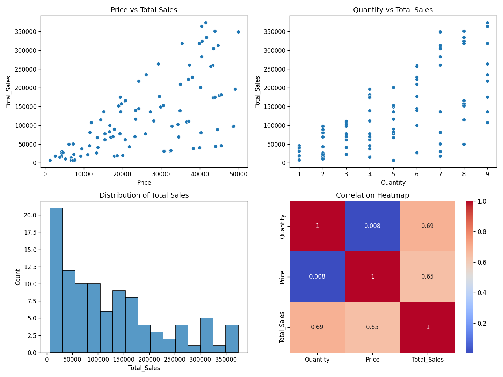

# Python Basics and Data Analysis — Skybrisk Internship

## Project Overview

This repository contains the practical work completed during Month 1 of the Skybrisk Data Science Internship. The project covers Python programming, data structures, basic data cleaning, NumPy, Pandas, and data visualization.

The work is organized by week, with Python scripts, a sales dataset, and a summary of the concepts practiced.

## Weekly Work

### Week 1 — Python Programming
- Celsius-to-Fahrenheit conversion
- Calculator using conditional statements
- Average temperature calculation
- Counting temperatures above the average using loops

### Week 2 — Data Structures and Functions
- Lists, tuples, dictionaries, and sets
- Functions, lambda expressions, recursion, and list comprehension
- Removing duplicate records and handling missing values
- Filtering records based on age

### Week 3 — NumPy and Pandas
- NumPy arrays, mathematical operations, and broadcasting
- Loading and inspecting a CSV dataset
- Checking and removing missing and duplicate records
- Selecting columns, indexing rows, calculating averages, and grouping data

### Week 4 — Data Visualization
- Scatter plots to compare sales with price and quantity
- Histogram to examine the distribution of total sales
- Correlation heatmap for numerical features

## Dataset

The sales dataset contains 100 records and the following columns:

`Date`, `Product`, `Quantity`, `Price`, `Customer_ID`, `Region`, and `Total_Sales`.

## Key Findings

- Total sales across the dataset: 12,365,048.00
- Average sales per record: 123,650.48
- Laptop has the highest average sales value among the listed products, at approximately 162,050.42.
- The West region has the lowest average sales value, at approximately 81,689.31.
- The correlation analysis shows positive relationships between Total Sales and Quantity (approximately 0.69) and between Total Sales and Price (approximately 0.65).

These findings describe the supplied dataset and should not be treated as conclusions about all sales or customers.

## Dashboard Preview

The dashboard contains two scatter plots, a histogram, and a correlation heatmap.

## Tools and Libraries

- Python
- NumPy
- Pandas
- Matplotlib
- Seaborn

## Setup and Execution

1. Install Python 3.
2. Download or clone this repository.
3. Open a terminal in the project directory.
4. Install the dependencies:

   `pip install -r requirements.txt`

5. Run the scripts individually:

   `python week1_python_basics.py`

   `python week2_data_structures.py`

   `python week3_numpy_pandas.py`

   `python week4_visualization_dashboard.py`

The scripts that use `sales_data.csv` expect the dataset to be available in the project directory. The Week 4 script generates the dashboard image when execution completes successfully.

## Learning Summary

The project provided practical experience with Python fundamentals, data structures, functions, dataset cleaning, numerical operations, aggregation, and exploratory data visualization.

See `summaries_of_concepts_learned.md` for the week-by-week summary.
